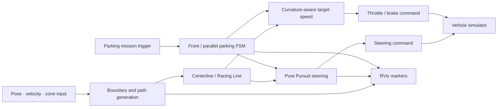

# 2025 SKKU Autonomous Driving Hackathon — 2nd Place

[한국어](README.md) | [English](README.en.md)

> A four-person project integrating path tracking, parking state machines, speed control, and debug visualization in a ROS Noetic simulator. My role covered **driving and parking control integration, fail-safe behavior, parameter tuning, and validation tools**.

| Item | Details |
|---|---|
| Period | Nov 21, 2025, 17:00 — Nov 22, 2025, 10:00 |
| Result | 2nd place; completed two of three parking missions |
| My contribution | Parking FSMs, Pure Pursuit integration, racing-line/speed control, RViz debugging |
| Environment | Ubuntu 20.04, ROS Noetic, Python, RViz, Ackermann steering |
| Code scope | Two personal integration files plus the competition/team runtime |

## Quick Navigation

- [`brain_final.py`](brain_final.py): integrated front/parallel-parking FSM and path tracking
- [`fsds_final.py`](fsds_final.py): integrated driving-line/speed control and RViz debugging
- [`Simulation/`](Simulation): competition/team simulator and mission environment
- [`Formula/`](Formula): competition/team Formula/FSDS messages and runtime
- [Contribution evidence](#5-my-contribution) · [Run instructions](#run-instructions) · [Attribution](#10-attribution)

## 1. Project Overview

The system generates a center path and optional racing-line candidates from cone and track information, calculates steering with Pure Pursuit, and adjusts speed according to curvature and steering demand. Normal driving, front parking, and parallel parking share one control flow. Target points, boundaries, paths, steering, and mission state are visualized in RViz.

Our competition strategy prioritized **two parking missions that had been validated while maintaining a fast pace on the normal-driving sections**. The team finished in second place.

## 2. Period and Result

- Event: Nov 21, 2025, 17:00 — Nov 22, 2025, 10:00
- Team: 4 members
- Final result: 2nd place
- Parking: completed front and parallel parking, two of three missions
- Evidence: verified from the team certificate issued on Nov 22, 2025

The original certificate is excluded because it contains other team members' personal information. The official number of teams, reproducible lap times, and controlled improvement rates were not independently verified and are therefore omitted.

## 3. Development Environment

| Area | Technology |
|---|---|
| Runtime | Ubuntu 20.04, ROS Noetic, Python |
| Planning | Cone boundaries, centerline, optional racing line, curvature calculation |
| Control | Pure Pursuit, Ackermann steering, throttle/brake, parking FSMs |
| Interface | ROS topics, FSDS custom messages |
| Validation | RViz markers, state/control logs, repeated simulation |

## 4. System Architecture



## 5. My Contribution

The contribution scope is based on commits whose Git author matches my account.

### Parking control and state machines

- [`a5c79ac`](https://github.com/choiYhunn/skku-autonomous-driving-hackathon-2025/commit/a5c79acdb57625928c2b94e1f68c199fe08fbe47): added the `brain_final.py` integration file
- Split front and parallel parking into approach, entry, alignment, stop, and correction states
- Used position/yaw error and timeouts as state-transition conditions
- Connected parking-path tracking and normal driving without competing command flows
- Bounded repeated corrections and recorded controller state

### Path tracking, speed control, and debugging

- [`c2c9fb7`](https://github.com/choiYhunn/skku-autonomous-driving-hackathon-2025/commit/c2c9fb76da8c2955963839435fbe0bbbbacc222e): added the `fsds_final.py` integration file
- Generated a center path and optional racing-line candidates from cone boundaries
- Adjusted look-ahead and target speed using curvature and velocity
- Connected Pure Pursuit steering to throttle/brake commands
- Published target, boundary, path, steering-arrow, and control-state RViz markers

### Repository cleanup

- [`d284aac`](https://github.com/choiYhunn/skku-autonomous-driving-hackathon-2025/commit/d284aac3d8d3b03878a3adc9ec3e62cc523bb6eb): added `.gitignore` and removed Python caches

These commits establish work on the integration files. They do not imply sole authorship of all baseline and team components inside those files.

## 6. Problems and Solutions

| Problem | Implementation | Validation |
|---|---|---|
| Parking was difficult to reproduce as continuous commands | Structured front/parallel parking as explicit FSM states and transitions | Completed the two corresponding missions during the event |
| Small path error created large steering changes at speed | Adjusted target speed and look-ahead by curvature and steering demand | Repeatedly balanced straight-line pace and corner stability |
| Normal and parking controllers could issue competing commands | Applied one state-dependent command path with safety conditions | Inspected state-specific output and transition logs |
| It was unclear whether failures originated in planning or tracking | Visualized boundaries, path, target, and steering separately in RViz | Distinguished planning faults from control faults on screen |

## 7. Validation and Result

- Inspected the centerline, target point, driving line, and steering direction in RViz.
- Repeatedly simulated normal driving and parking-state transitions.
- Completed front and parallel parking during the competition.
- Combined the validated parking flow with a high-speed normal-driving strategy and finished second.
- No automated regression suite or quantitative log supports an isolated performance gain for the speed strategy.

## Run Instructions

The repository depends on the original team environment and ROS package layout. The commands below are recorded from the repository and have not been revalidated end to end in the current environment.

```bash
sudo apt-get install ros-noetic-tf2-geometry-msgs \
  ros-noetic-ackermann-msgs ros-noetic-joy ros-noetic-map-server

cd ~/catkin_ws
catkin_make
source devel/setup.bash

cd ~/catkin_ws/src/2025_HEVEN_Hackathon/Simulation
bash simulate.sh <map-number>
bash brain.sh
```

The Formula/FSDS controller uses:

```bash
roslaunch formula control.launch
```

## 8. Repository Structure

```text
.
├─ brain_final.py       # Personal commit: parking FSM and path-tracking integration
├─ fsds_final.py        # Personal commit: driving line, speed control, and debugging
├─ Simulation/          # Competition/team simulator and mission environment
├─ Formula/             # Competition/team Formula/FSDS runtime
├─ README.md            # Korean documentation
└─ README.en.md         # English documentation
```

## 9. Limitations

- The two integration files depend on competition messages, team packages, and baseline structure.
- No automated tests or quantitative logs support a numerical stability or lap-time improvement claim.
- This is a simulation project and does not validate real-vehicle sensor noise, actuator delay, or saturation.
- Optional racing-line optimization requires separate checks for runtime configuration and computation cost.

## 10. Attribution

- Upstream repository: [`jooeonjohn/2025_HEVEN_Hackathon`](https://github.com/jooeonjohn/2025_HEVEN_Hackathon)
- This repository is a fork and contains competition infrastructure and work from multiple team members.
- My contribution is limited to the three linked commits and the verified functional scope above.
- No separate license was found; this README does not grant new permission for team or third-party code.
