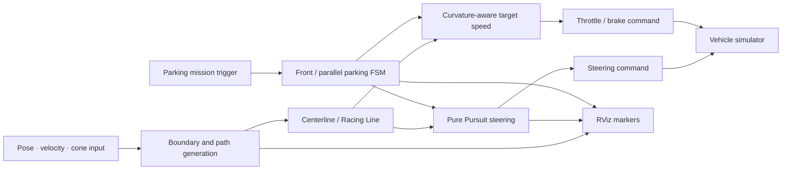

# 2025 성균관대학교 자율주행 해커톤 — 최종 2위

[한국어](README.md) | [English](README.en.md)

> ROS Noetic 시뮬레이터에서 경로 추종, 주차 상태 머신, 속도 제어와 디버그 시각화를 통합한 4인 팀 프로젝트입니다. 저는 **주행·주차 제어 통합, Fail-Safe, 파라미터 튜닝과 검증 도구**를 담당했습니다.

| 항목 | 내용 |
|---|---|
| 기간 | 2025.11.21 17:00 — 2025.11.22 10:00 |
| 결과 | 최종 2위, 주차 미션 3개 중 2개 완료 |
| 개인 기여 | 주차 FSM, Pure Pursuit 통합, Racing Line·속도 제어, RViz 디버깅 |
| 환경 | Ubuntu 20.04, ROS Noetic, Python, RViz, Ackermann steering |
| 코드 범위 | 개인 통합 파일 2개 + 대회/팀 제공 실행 환경 |

## 빠른 탐색

- [`brain_final.py`](brain_final.py): 전면·평행 주차 FSM과 경로 추종 통합본
- [`fsds_final.py`](fsds_final.py): 주행선·속도 제어와 RViz 디버그 통합본
- [`Simulation/`](Simulation): 대회/팀 시뮬레이터와 미션 환경
- [`Formula/`](Formula): 대회/팀 Formula·FSDS 메시지 및 실행 환경
- [개인 기여 근거](#5-my-contribution) · [실행 방법](#실행-방법) · [Attribution](#10-attribution)

## 1. 프로젝트 개요

콘과 트랙 정보에서 중심 경로와 주행 후보선을 생성하고, Pure Pursuit로 조향하며, 곡률과 조향 요구량에 따라 속도를 조절하는 자율주행 시스템입니다. 일반 주행과 전면·평행 주차를 하나의 제어 흐름으로 연결하고, 목표점·경계·주행선·조향 상태를 RViz에서 확인할 수 있도록 구성했습니다.

대회에서는 모든 주차를 느리게 시도하기보다 **검증된 주차 2개를 완료하면서 일반 주행 구간의 속도를 높이는 전략**을 적용해 최종 2위를 기록했습니다.

## 2. 기간 및 결과

- 대회 일정: 2025.11.21 17:00 — 2025.11.22 10:00
- 팀 구성: 4명
- 최종 결과: 2위
- 주차 결과: 전체 3개 미션 중 전면·평행 주차 2개 완료
- 수상 근거: 2025.11.22 발급 팀 상장으로 확인

상장 원본은 다른 팀원의 개인정보가 있어 저장소에 포함하지 않았습니다. 공식 참가 팀 수, 재현 가능한 랩타임과 조건별 개선율은 확인되지 않아 기재하지 않습니다.

## 3. 개발 환경

| 구분 | 사용 항목 |
|---|---|
| Runtime | Ubuntu 20.04, ROS Noetic, Python |
| Planning | 콘 경계, 중심선, 선택적 Racing Line, 곡률 계산 |
| Control | Pure Pursuit, Ackermann steering, throttle/brake, 주차 FSM |
| Interface | ROS topic, FSDS custom message |
| Validation | RViz marker, 상태·제어 로그, 반복 시뮬레이션 |

## 4. 시스템 구조



## 5. My Contribution

Git author가 제 계정과 일치하는 커밋을 기준으로 범위를 확인했습니다.

### 주차 제어와 상태 머신

- [`a5c79ac`](https://github.com/choiYhunn/skku-autonomous-driving-hackathon-2025/commit/a5c79acdb57625928c2b94e1f68c199fe08fbe47): `brain_final.py` 통합본 추가
- 전면 주차와 평행 주차를 접근, 진입, 정렬, 정지, 보정 단계로 분리
- 위치·yaw 오차와 timeout을 상태 전환 조건으로 적용
- 주차 경로 추종과 일반 주행 명령이 충돌하지 않도록 실행 흐름 연결
- 반복 보정 횟수에 상한을 두고 제어 상태를 기록

### 경로 추종·속도 제어와 디버그 도구

- [`c2c9fb7`](https://github.com/choiYhunn/skku-autonomous-driving-hackathon-2025/commit/c2c9fb76da8c2955963839435fbe0bbbbacc222e): `fsds_final.py` 통합본 추가
- 콘 경계에서 중심 경로와 선택적 Racing Line 후보 생성
- 곡률과 속도에 따른 look-ahead 및 목표 속도 조정
- Pure Pursuit 조향과 throttle/brake 명령 연결
- 목표점, 경계, 주행선, 조향 화살표와 제어 정보를 RViz marker로 게시

### 저장소 정리

- [`d284aac`](https://github.com/choiYhunn/skku-autonomous-driving-hackathon-2025/commit/d284aac3d8d3b03878a3adc9ec3e62cc523bb6eb): `.gitignore` 추가 및 Python cache 제거

위 커밋은 해당 통합 파일의 작성·수정 근거이며, 파일 안의 기반 구조와 팀 구성 요소까지 모두 단독 작성했다는 의미는 아닙니다.

## 6. 주요 문제와 해결

| 문제 | 구현 | 검증 |
|---|---|---|
| 연속 명령만으로 주차 절차를 재현하기 어려움 | 전면·평행 주차를 명시적 FSM과 전환 조건으로 구성 | 대회에서 해당 주차 미션 2개 완료 |
| 고속에서 작은 경로 오차가 큰 조향 변화로 이어짐 | 곡률·조향량에 따른 목표 속도와 look-ahead 조정 | 직선 속도와 코너 안정성을 함께 반복 확인 |
| 일반 주행과 주차 제어가 동시에 명령할 가능성 | 미션 상태에 따른 단일 명령 흐름과 안전 조건 적용 | 상태별 출력과 전환 로그 확인 |
| 실패 원인이 경로 생성인지 추종인지 불명확 | 경계·경로·목표점·조향 정보를 RViz에 분리 표시 | 화면에서 planning과 control 문제를 구분 |

## 7. 검증 및 결과

- RViz에서 중심선, 목표점, 주행선과 조향 방향을 확인했습니다.
- 일반 주행과 주차 상태 전환을 반복 시뮬레이션으로 점검했습니다.
- 대회 주행에서 전면·평행 주차 미션을 완료했습니다.
- 일반 구간의 고속 주행 전략을 함께 적용해 최종 2위를 기록했습니다.
- 자동화된 회귀 테스트와 정량 로그가 없어 속도 전략만의 성능 개선 폭은 주장하지 않습니다.

## 실행 방법

이 저장소는 원본 팀 환경과 ROS package 구성에 의존합니다. 아래는 저장소에 기록된 절차이며 현재 환경에서 end-to-end로 재검증하지 않았습니다.

```bash
sudo apt-get install ros-noetic-tf2-geometry-msgs \
  ros-noetic-ackermann-msgs ros-noetic-joy ros-noetic-map-server

cd ~/catkin_ws
catkin_make
source devel/setup.bash

cd ~/catkin_ws/src/2025_HEVEN_Hackathon/Simulation
bash simulate.sh <map-number>
bash brain.sh
```

Formula/FSDS 제어 노드는 다음 launch 구성을 사용합니다.

```bash
roslaunch formula control.launch
```

## 8. 저장소 구조

```text
.
├─ brain_final.py       # 개인 커밋: 주차 FSM·경로 추종 통합본
├─ fsds_final.py        # 개인 커밋: 주행선·속도 제어·디버그 통합본
├─ Simulation/          # 대회/팀 시뮬레이터와 미션 환경
├─ Formula/             # 대회/팀 Formula·FSDS 실행 환경
├─ README.md            # 한국어 설명
└─ README.en.md         # English documentation
```

## 9. 한계

- 두 통합 파일은 대회 메시지, 팀 package와 baseline 구조에 의존합니다.
- 자동 테스트와 정량 로그가 없어 제어 안정성이나 랩타임 개선율을 수치로 주장하지 않습니다.
- 시뮬레이션 프로젝트이며 실차의 센서 노이즈, actuator delay와 saturation을 검증하지 않았습니다.
- 선택적 Racing Line 최적화는 기본 실행 조건과 계산 비용을 별도로 확인해야 합니다.

## 10. Attribution

- 원본 저장소: [`jooeonjohn/2025_HEVEN_Hackathon`](https://github.com/jooeonjohn/2025_HEVEN_Hackathon)
- 이 저장소는 원본의 fork이며 대회 제공 환경과 여러 팀원의 작업을 포함합니다.
- 개인 기여는 위에 연결한 세 커밋과 확인된 기능 범위로 한정합니다.
- 별도 라이선스가 확인되지 않았으므로 이 README는 팀 또는 제3자 코드에 새로운 사용 허가를 부여하지 않습니다.
